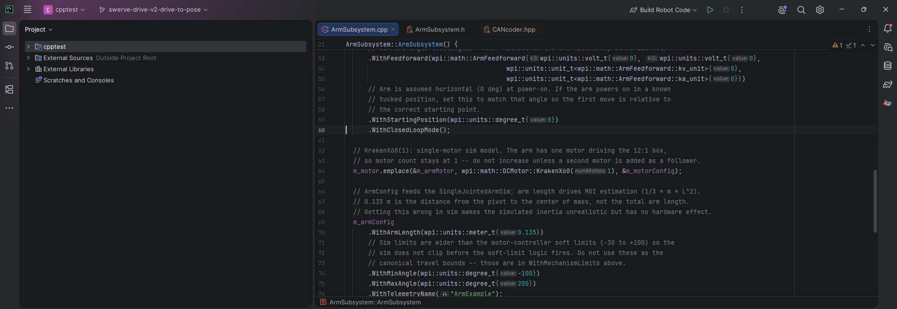
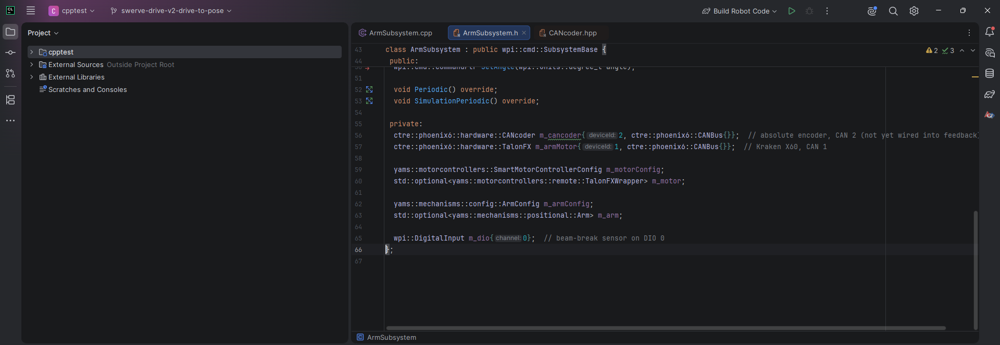
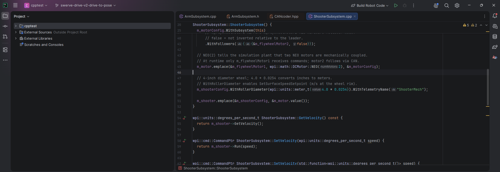

When we [took on the FRC IntelliJ plugin](/blog/frc-intellij-plugin) earlier this month, we said we wanted it to help C++ teams too. The first beta of that is out: **[2026.6.5 beta 2](https://github.com/thenetworkgrinch/frc-intelij-plugin/releases/tag/v2026.6.5-beta2)** runs in CLion 2026.2 and opens WPILib C++ robot projects properly.

Here it is in CLion 2026.2.3 with `examples/cpptest`, the C++ example project in the [YAMS repository](https://github.com/Yet-Another-Software-Suite/YAMS), with its arm subsystem open:

The little grey labels (`kS:`, `value:`, `numMotors:`) are CLion's parameter hints. CLion can only show them when it has found the WPILib and YAMS headers and knows how the file is compiled, so they're a quick way to see it's working. The **Build Robot Code** run configuration at the top comes from the plugin too.

## The problem it solves

A WPILib C++ project is built by GradleRIO, not CMake, so out of the box CLion doesn't know where WPILib's headers are or which flags the code is compiled with. You open `Robot.cpp`, every `#include <frc/...>` is red, and there's no completion or go to definition for anything from WPILib or a vendordep.

The plugin fixes that by generating compile commands from the project's Gradle build, including the WPILib and vendordep headers, so CLion's code insight works the way it does on a CMake project. Here's the arm's header, with the Phoenix 6 `TalonFX` and `CANcoder`, the YAMS config and mechanism types, and a WPILib `DigitalInput`, all resolved:

The icons in the gutter next to `Periodic()` and `SimulationPeriodic()` take you to the `SubsystemBase` methods they override, inside WPILib's headers.

## What's in the beta

- **CLion support for WPILib C++ robot projects.** Open a GradleRIO C++ project and CLion understands it.
- **Compile commands for WPILib and vendordep headers.** Completion, navigation and error highlighting work through WPILib, YAMS and the other vendordeps you've installed.
- **Pick which libraries get compile commands.** Indexing every vendordep's headers can be slow, so you can choose which libraries CLion indexes.
- **Projects below the folder you opened.** If your robot project is nested in a larger repository (like `examples/cpptest` in YAMS), the plugin still finds it.
- **2026 project templates.** The New Project wizard has the 2026 templates, and the 2025 templates are fixed.

## Trying it

It's a beta, so expect rough edges. Download `FRC-2026.6.5-2026.2-beta2.zip` from the [release](https://github.com/thenetworkgrinch/frc-intelij-plugin/releases/tag/v2026.6.5-beta2), then in CLion open **Settings ▸ Plugins**, click the gear icon, choose **Install Plugin from Disk…**, pick the zip and restart.

If CLion still shows red includes, or a vendordep's headers aren't picked up, [open an issue](https://github.com/thenetworkgrinch/frc-intelij-plugin/issues) with your CLion version and your project's `vendordeps` folder, or find us on the [YASS Discord](https://discord.gg/yass).
