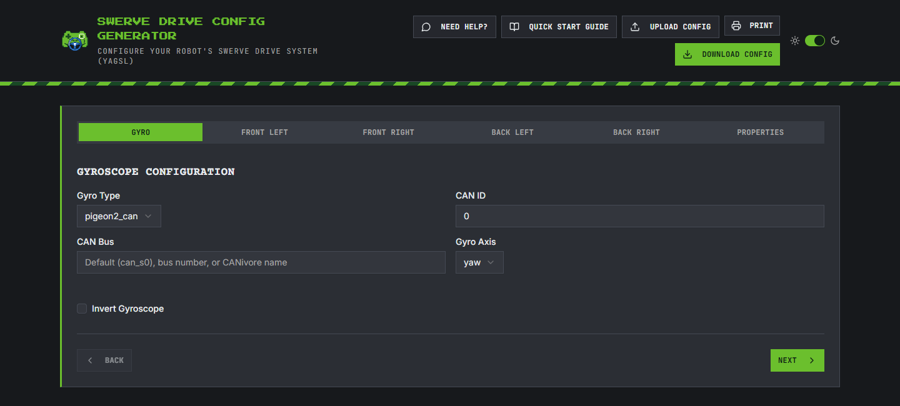
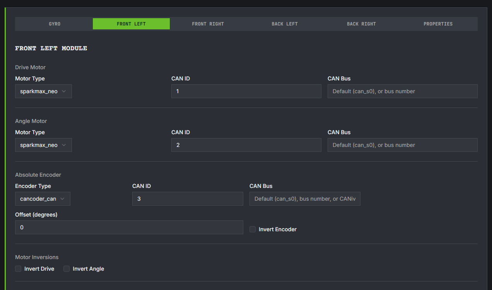
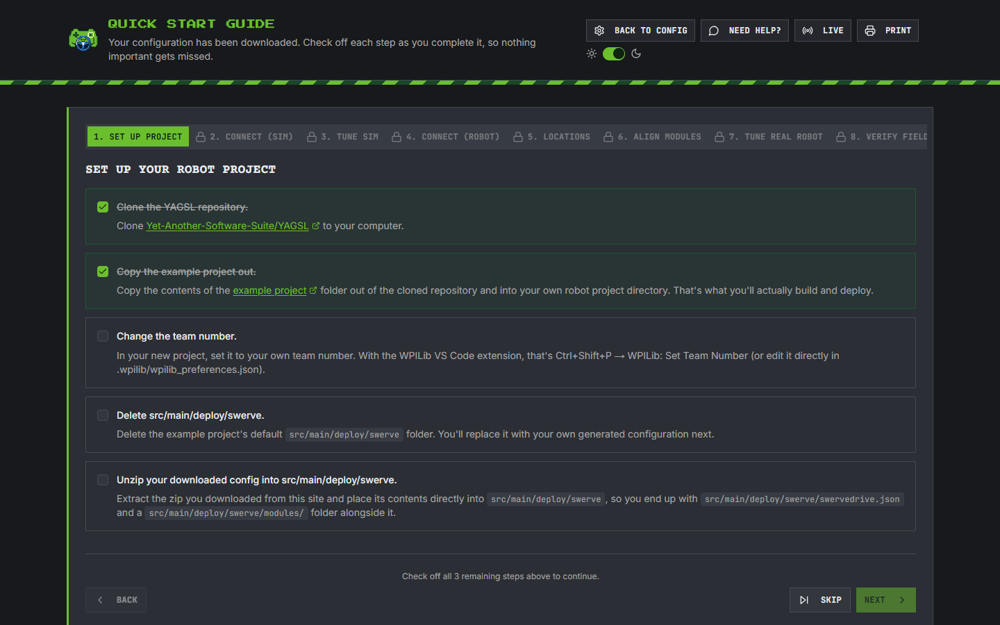
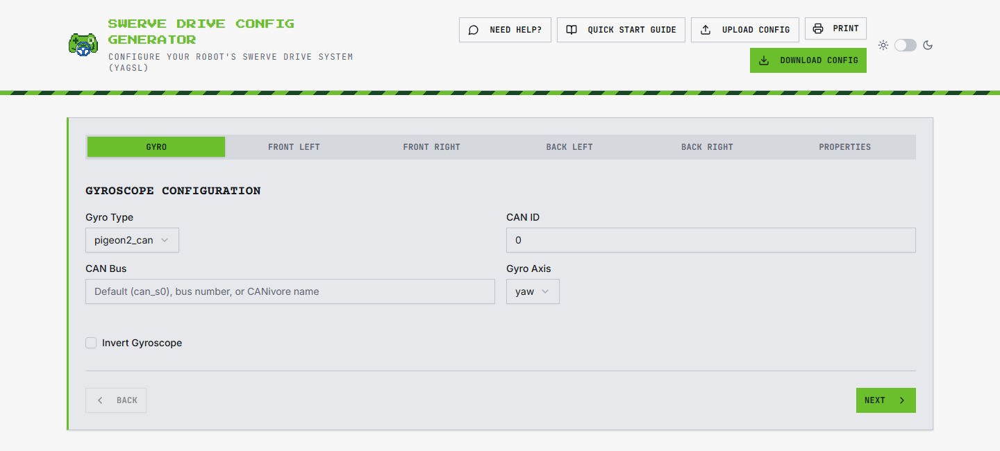
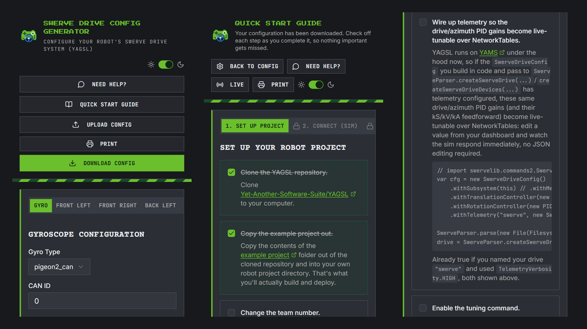

The [YAGSL swerve drive config generator](https://config.yagsl.com) has been restyled to match this website and [YAMG's new look](/blog/yamg-new-look).

It still makes the same configuration files. You fill in your gyro, your four modules and your robot's properties, then download them. The Quick Start Guide then walks you through using them in a new project.

## Before and after

Here's how it looked in the [YAMS and YAGSL 2027 alpha 7 post](/blog/yams-yagsl-2027-alpha7):

The new look uses the YASS website's design:

- **Colours:** dark graphite surfaces, with Bright Fern green for the buttons, the active tab, links and the edge of each card.
- **Fonts:** the page titles in a green pixel font, headings in Courier Prime, text in Inter, and buttons, tabs and code in JetBrains Mono.
- **The page:** the blueprint grid behind everything, and the green stripe under the header.
- **Corners:** square, with uppercase buttons and tabs.
- **The logo:** the header and the browser tab now show the YAGSL logo.

Each module's tab has the same look, with its drive motor, angle motor, absolute encoder, inversions and location grouped under their own labels:

## The Quick Start Guide

The Quick Start Guide is still a checklist, now in the new colours. Each step you tick turns green and is struck through, so you can see where you are at a glance. Tabs you haven't reached yet show a lock until you get to them.

## Light mode and printing

Dark is now the default, like this website. The switch in the top corner still turns on light mode, and the site remembers your choice:

**Print** still prints on plain white paper, with no grid or dark background. You can keep a copy of your configuration and the guide's checklist in the pit.

## On your phone

Both pages fit a phone, in portrait or landscape. Wide code samples in the guide now scroll inside their own box instead of making the whole page wider than the screen:

## Feedback

The config generator is open source: [github.com/Yet-Another-Software-Suite/yagsl2027_config_generator](https://github.com/Yet-Another-Software-Suite/yagsl2027_config_generator). If something is hard to read or find in the new look, open an issue, or tell us on the [YASS Discord](https://discord.gg/yass).
