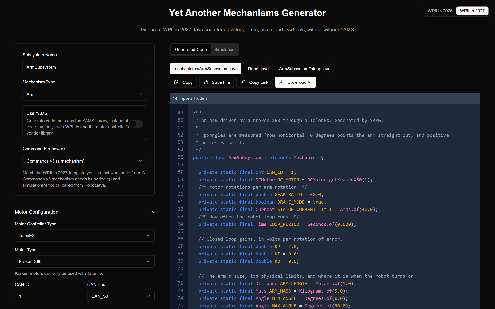
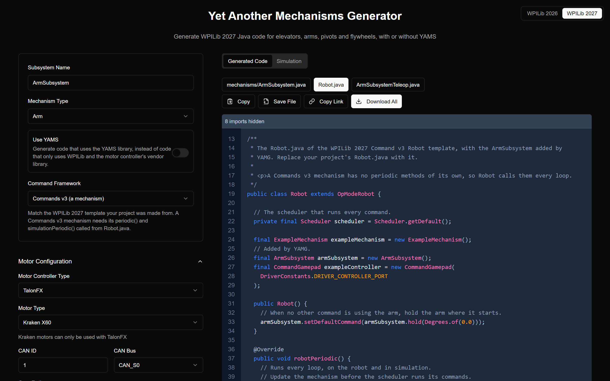
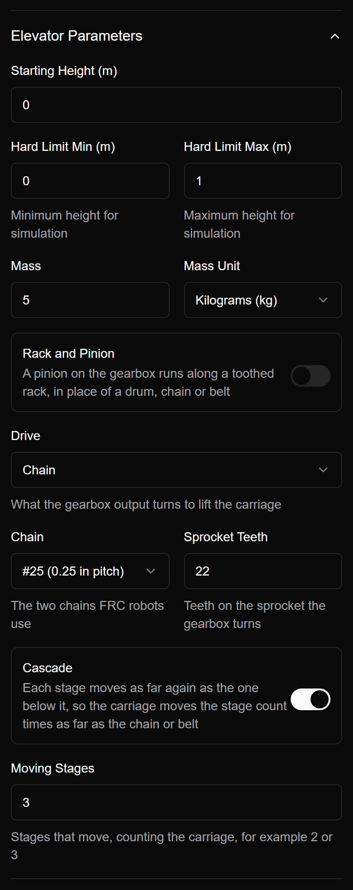
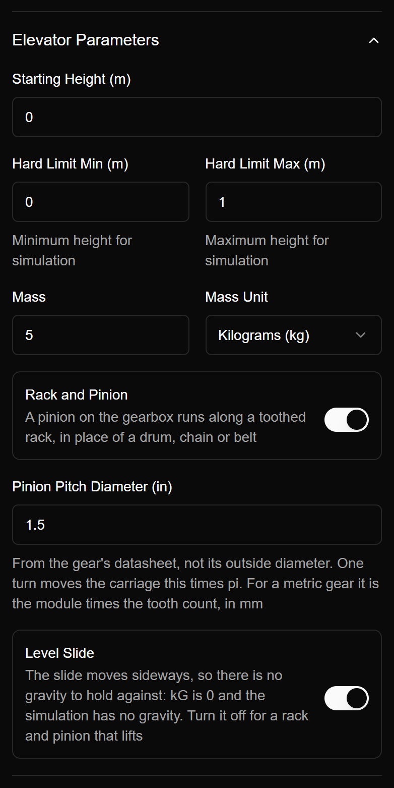
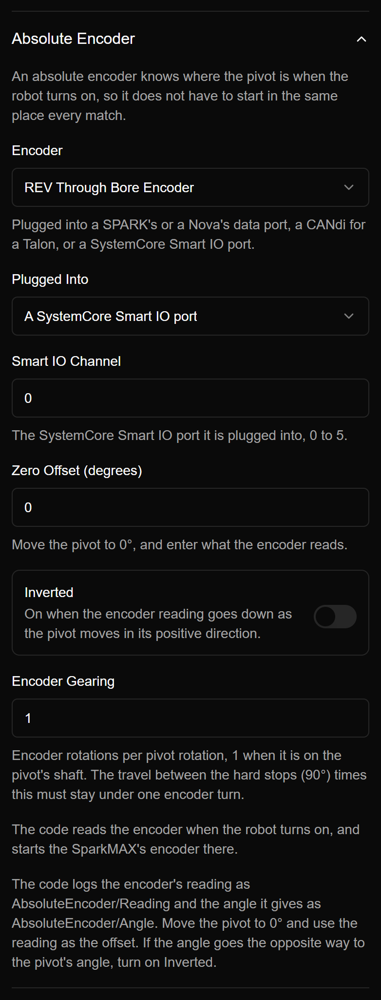
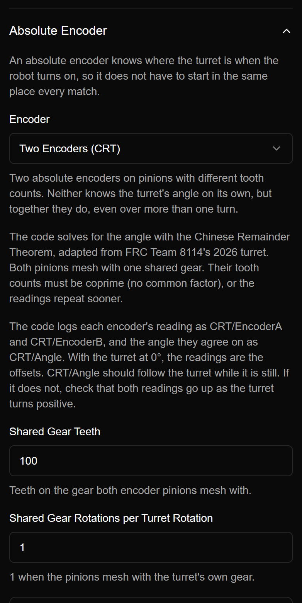
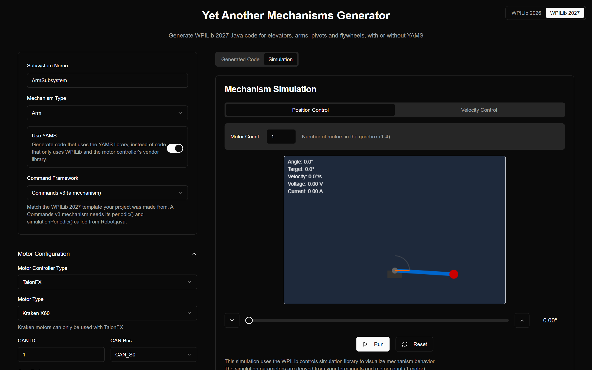
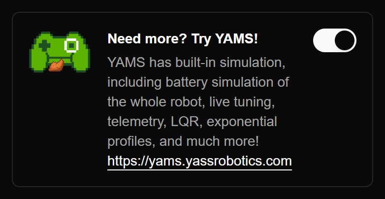

YAMG (Yet Another Mechanisms Generator) has been updated for the 2027 season. We've retired yamgen.com, and YAMG now lives at [yamg.yassrobotics.com](https://yamg.yassrobotics.com).

If you haven't used it before: you describe a mechanism (an elevator, arm, pivot, turret or flywheel, with its motor, controller, gearing, gains and limits), and YAMG writes the Java for it and simulates it right in your browser. You can download the code, copy it into your project and deploy it.



The goal hasn't changed since last year: a new programmer should be able to get a working, simulated mechanism on the robot in an afternoon, and be able to read every line of the code that does it. A lot of this update is about the second half of that. The generated code is commented throughout, so it explains why each line is there.

## WPILib 2027, Commands v2 or v3

YAMG now generates code for WPILib 2027 and the SystemCore. Choose a Commands v2 subsystem or a Commands v3 mechanism to match the template your project was made from.

You also get the robot files that use your mechanism, based on the WPILib 2027 templates:

- **Commands v2:** the subsystem, plus `Robot.java` and a `RobotContainer.java` with the subsystem and a default command.
- **Commands v3:** the mechanism, plus `Robot.java` (a v3 mechanism has no periodic methods of its own, so `Robot` calls them every loop) and a teleop op mode with gamepad bindings, so you can pick it on the driver station and drive the mechanism straight away.

**Download All** gives you a zip already laid out as `src/main/java/first/robot/...`, so it drops straight into a new project.



Here's the teleop op mode YAMG writes for an arm. The A and B buttons send it to an angle with the closed loop, and X and Y drive it with a duty cycle while you're checking which way it goes:

```java
@Teleop(name = "ArmSubsystem Teleop", description = "Drive the arm from the gamepad")
public class ArmSubsystemTeleop implements OpMode {

  public ArmSubsystemTeleop(Robot robot) {
    robot.exampleController.faceDown().whileTrue(robot.armSubsystem.setAngle(Degrees.of(0.0)));
    robot.exampleController.faceRight().whileTrue(robot.armSubsystem.setAngle(Degrees.of(45.0)));
    robot.exampleController.faceLeft().whileTrue(robot.armSubsystem.set(0.3));
    robot.exampleController.faceUp().whileTrue(robot.armSubsystem.set(-0.3));
  }
}
```

The v3 commands are written as coroutines, the way Commands v3 is meant to be used:

```java
/** Go to an angle and hold it. This command does not end on its own. */
public Command setAngle(Angle angle) {
  return run(coroutine -> {
    while (true) {
      setGoal(angle);
      coroutine.yield();
    }
  }).named("ArmSubsystem Set Angle");
}
```

A v3 mechanism also gets a `hold` command at the lowest priority, which `Robot` uses as the default, so any other command can take over. Every mechanism, v2 or v3, gets a `near` trigger for "is it there yet", and a `getGoal()` you can check from other code.

## Units everywhere

The generated code uses WPILib units (`Distance`, `Angle`, `AngularVelocity`, `Current`, `Mass`) instead of bare doubles, from the constants at the top of the file down to the commands. No more guessing whether `ARM_MAX` is in degrees, radians or rotations:

```java
private static final Distance ARM_LENGTH = Meters.of(1.0);
private static final Mass ARM_MASS = Kilograms.of(5.0);
private static final Angle MIN_ANGLE = Degrees.of(0.0);
private static final Angle MAX_ANGLE = Degrees.of(90.0);
private static final Current STATOR_CURRENT_LIMIT = Amps.of(40.0);
```

## Logging with Telemetry or Epilogue

You can log with WPILib's Telemetry or with Epilogue. Either way the mechanism logs its position, velocity and voltage (and temperature and current if you turn them on), a Mechanism2d drawing, and its **goal**, so you can graph where the closed loop is trying to go against where the mechanism really is. That's usually the first graph you want when tuning.

## The motor controller does the work

With plain vendor code, the TalonFX, TalonFXS, SPARK MAX and SPARK Flex now run the gearing, the motion profile and the feedforward on the motor controller itself, instead of on the SystemCore:

- **Talons** use Motion Magic. Phoenix applies the gear ratio, so positions, speeds, soft limits and gains are all in turns of the mechanism. YAMG only sends the goal when it changes.
- **SPARKs** use MAXMotion, with kS, kV, kA and kG configured on the SPARK. REVLib 2027 has no conversion factors, so the code converts the gains and limits to motor rotations for you, with comments showing how.
- **The Thrifty Nova** runs its PID on the SystemCore, and now has a supply current limit option.

For an arm on a Talon, gravity compensation is configured with `Arm_Cosine`, so kG is scaled by the cosine of the arm's angle on the Talon:

```java
config.Feedback.withSensorToMechanismRatio(GEAR_RATIO);
config.Slot0.withKP(KP).withKI(KI).withKD(KD);
// Arm_Cosine scales kG by the cosine of the arm's angle, which is 0 when the arm points straight out.
config.Slot0.withGravityType(GravityTypeValue.Arm_Cosine).withKG(0.3);
config.MotionMagic.withMotionMagicCruiseVelocity(MAX_VELOCITY)
    .withMotionMagicAcceleration(MAX_ACCELERATION);
```

The Talon and SPARK code is simulated through the vendor's own simulation, so the closed loop you tune in simulation is the one that runs on the robot.

> REVLib's simulation doesn't follow a MAXMotion profile yet, and it works out kCos from the setpoint instead of the position. So in simulation the generated SPARK code runs the profile on the SystemCore, sends kV, kA and the arm's gravity as an arbitrary feedforward, and keeps kS (and an elevator's kG) on the SPARK. On the real robot it uses MAXMotion. We wrote these up for REV, along with a few other simulation bugs we found, in [wpilibsuite/SystemcoreTesting#425](https://github.com/wpilibsuite/SystemcoreTesting/issues/425), with a [test project](https://github.com/Yet-Another-Software-Suite/yamg/tree/revlib-sim-tests/revlib-sim-tests) that reproduces each of them.

## Elevators: drum, chain, belt, cascade or rack and pinion

In 2026 you had to enter an elevator's drum radius, which was awkward if your elevator doesn't have a drum. Now you describe how it's really driven, and YAMG works out how far the carriage moves per turn:

- **Drum** (spool and rope): the drum's radius.
- **Chain:** #25 or #35, and the sprocket's tooth count.
- **Belt:** the belt's pitch and the pulley's tooth count.
- **Cascade:** how many stages move. Each stage moves as far again as the one below it, so the carriage moves that many times as far as the chain or belt.
- **Rack and pinion:** the pinion's pitch diameter, from the gear's datasheet. Mark it as a **level slide** for one that moves sideways: there's no kG and no gravity in the simulation. Turn that off for a rack and pinion that lifts.

 

The math ends up in the code, with comments, so you can check it:

```java
/** How far the chain, belt or rope moves for each turn of the sprocket: a 22 tooth sprocket on #25 chain, which moves 0.25 in per tooth. */
private static final Distance DRIVE_CIRCUMFERENCE = Inches.of(0.25).times(22);
/**
 * The elevator is a 3 stage cascade. Each stage moves as far again as the one below
 * it, so the carriage moves 3 times as far as the chain or belt.
 */
private static final int CASCADE_STAGES = 3;
/** How far the carriage moves for each turn of the sprocket. */
private static final Distance TRAVEL_PER_ROTATION = DRIVE_CIRCUMFERENCE.times(CASCADE_STAGES);
```

## Absolute encoders

Arms, pivots and the new turret can use an absolute encoder, so they know where they are when the robot turns on:

- **Encoders:** a CTRE CANcoder, a REV Through Bore, a Thrifty 10-pin magnetic encoder, or any duty cycle encoder.
- **Where it's plugged in:** a SPARK's or Nova's data port, a CANdi's PWM input for a Talon, or a SystemCore Smart IO port. YAMG only offers the options that work with your motor controller.
- **Setup:** the zero offset, whether it's inverted, and its gearing to the mechanism. The form shows the travel between your hard stops, which has to fit in one turn of the encoder.

When the robot turns on, the code reads the encoder and starts the motor's encoder there. It logs the raw reading and the angle it works out, so finding the offset is just: move the mechanism to zero, read the value, and type it in.

## Turrets and CRT

The turret is a new mechanism type. A turret usually turns more than one encoder rotation, so one absolute encoder isn't enough. Pick **Two Encoders (CRT)** instead: two absolute encoders on pinions with different tooth counts that both mesh with one shared gear. Neither encoder knows the turret's angle on its own, but the pair of readings is unique over the whole range, and the Chinese Remainder Theorem finds it. CRT works for arms and pivots too.

 

The tooth counts have to be coprime (no common factor), or the readings repeat sooner. YAMG shows how much travel your pinions can tell apart next to what your hard limits need. With 19 and 21 tooth pinions on a 100 tooth gear, for example, that's 1436° of travel, plenty for a turret that needs 360°.

The solver is adapted from [FRC Team 8114](https://www.thebluealliance.com/team/8114)'s 2026 turret. It tries rounding each encoder's tooth both ways, solves each combination, and keeps the one that fits the travel best. That makes it robust to a little backlash and noise. If the encoders don't agree on any angle, it raises an alert instead of guessing:

```java
// The turret's angle when the robot turns on comes from two absolute encoders, on pinions with
// 19 and 21 teeth that both mesh with a 100 tooth gear. Neither knows the angle on its
// own, but the pair of readings is unique over the turret's travel (the Chinese Remainder Theorem).
private final Alert crtAlert = new Alert(
  "TurretSubsystem",
  "The turret encoders do not agree on an angle. Check their offsets and inversion.",
  Alert.Level.HIGH
);
```

The code logs both readings and the angle they agree on, so you can check the setup on the cart before the turret ever moves.

## Every CAN device on its own bus

The SystemCore has more than one CAN bus. YAMG lets you choose the bus for each motor controller and each CAN encoder (CAN_S0, CAN_S1, and so on), and the generated code creates each device on that bus.

## Share a mechanism with a link

**Copy Link** puts the whole form in the URL. Only the fields you changed are saved, and they're compressed, so the links stay short. Send one to a teammate, or post it when you're asking for help on Discord or Chief Delphi, and it opens with exactly the same mechanism. The form is stored in the part of the URL after the `#`, which is never sent to a server, so nothing about your mechanism leaves your browser.

## Simulation in the browser

Same as in 2026, the simulation tab runs your mechanism with WPILib's physics models, using the gearing, mass and gains from the form. You can run position or velocity control, drag the setpoint, and try more motors in the gearbox to see if the mechanism is fast enough before you commit to a design. It updates as you change the form, so it's a quick way to get gains in the right range.



## Works on your phone

The layout now works on a phone, with the inputs, the code and the simulation on their own tabs. That's handy when you're checking a gear ratio in the pits.

## Still on 2026?

The 2026 version is still up at [yamg.yassrobotics.com/2026](https://yamg.yassrobotics.com/2026/). Use the WPILib 2026 / 2027 switch in the top corner to swap between them.

## Need more? Try YAMS

The plain code is meant to be readable and yours to change. When you want more than that, flip the YAMS switch at the end of the form, and YAMG writes the same mechanism using [YAMS](https://yams.yassrobotics.com). YAMS adds:

- simulation of the whole robot's battery, so you can see brownouts coming
- live tuning of the gains, the profile and the limits from a dashboard while the robot runs
- telemetry at the verbosity you choose
- LQR and exponential profiles
- swerve, double jointed arms, differential mechanisms and more



## Feedback

YAMG is open source: [github.com/Yet-Another-Software-Suite/yamg](https://github.com/Yet-Another-Software-Suite/yamg). If something generates code that doesn't compile, or doesn't behave the way you expect, open an issue with your share link so we can reproduce it, or find us on the [YASS Discord](https://discord.gg/yass).
