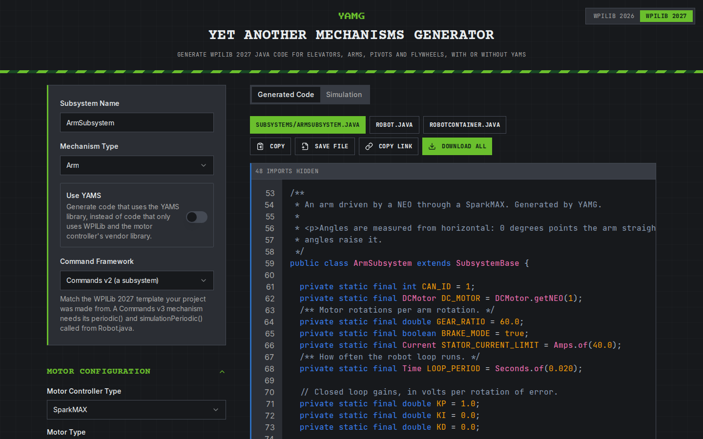
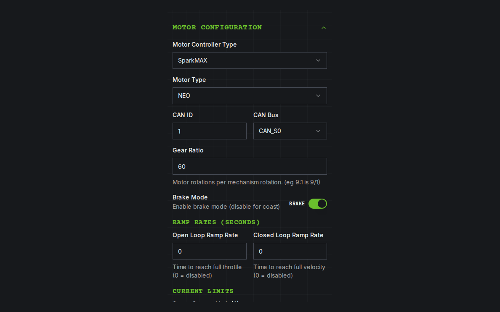
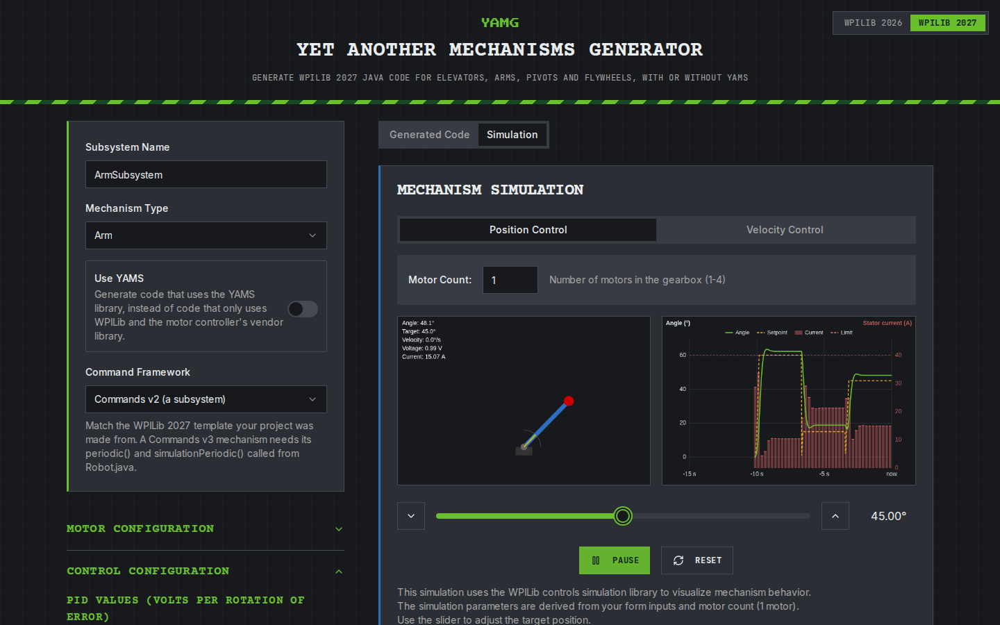
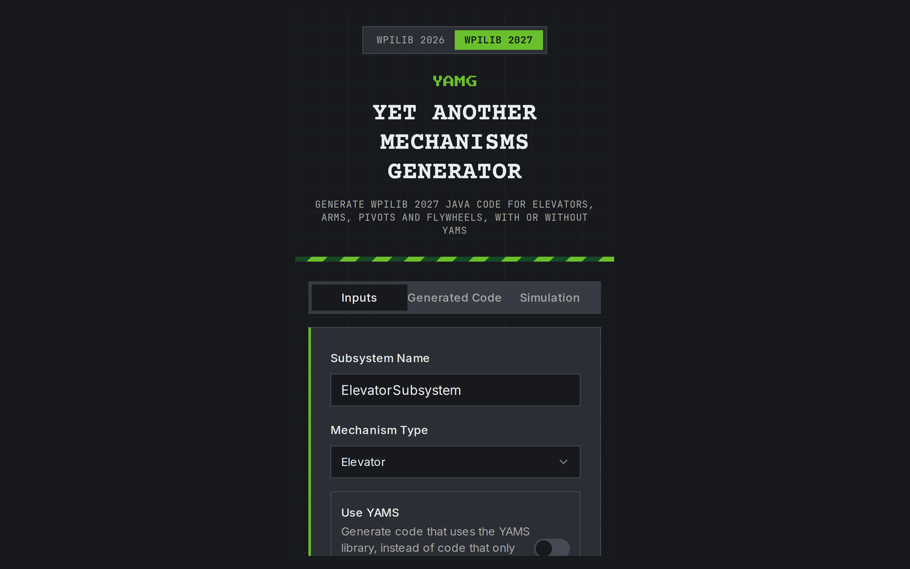

[YAMG](https://yamg.yassrobotics.com) (Yet Another Mechanisms Generator) has been restyled to match this website. It now looks like the rest of YASS, including the [YAMS Live Tuner](https://tuning.yassrobotics.com).

Nothing about the code it generates has changed. The same form gives you the same code, and share links you've already posted still open the same mechanism.

## Before and after

Here's how it looked last week, in the [YAMG 2027 post](/blog/yamg-2027):

The new look uses the YASS website's design:

- **Colours:** dark graphite surfaces, Bright Fern green for the things you act on, and YAMS blue along the edge of the code and simulation panels.
- **Fonts:** headings in Courier Prime, text in Inter, and code and labels in JetBrains Mono, with a small pixel YAMG wordmark at the top.
- **The page:** the blueprint grid behind everything, and the green stripe under the header.
- **Corners:** square, with uppercase buttons, like the cards on this site.

## A form that's easier to scan

The form is long, so it's now easier to find your way around. Every section (Motor Configuration, Control Configuration, Telemetry, Homing and the rest) and every group inside one (Ramp Rates, Current Limits, PID Values, Feedforward and so on) has a green heading, larger than the field labels under it. The top of the form, where you name the mechanism and pick its type, has a green edge.

## Brake or coast

The brake mode switch now says what it does. It reads **Brake** when it's on and **Coast** when it's off, so you don't have to remember which way round it goes:

## The code and the simulation

The generated code sits on a graphite panel in JetBrains Mono, with the same syntax colours as before.

The simulation has the new colours too. On the graph, the measured angle (or height, or speed) is green, the setpoint is yellow and the stator current is red. The mechanism's current and target markers match the graph. Here a NEO at 60:1 moves an arm to 60°, down to 15° and back up to 45°:

## On your phone

The phone layout is the same as before, with the inputs, the code and the simulation on their own tabs, in the new look:

## Still on 2026?

The 2026 version at [yamg.yassrobotics.com/2026](https://yamg.yassrobotics.com/2026/) keeps its old look for now. Use the WPILib 2026 / 2027 switch in the top corner to swap between them.

## Feedback

YAMG is open source: [github.com/Yet-Another-Software-Suite/yamg](https://github.com/Yet-Another-Software-Suite/yamg). If something is hard to read or find in the new look, open an issue, or tell us on the [YASS Discord](https://discord.gg/yass).
