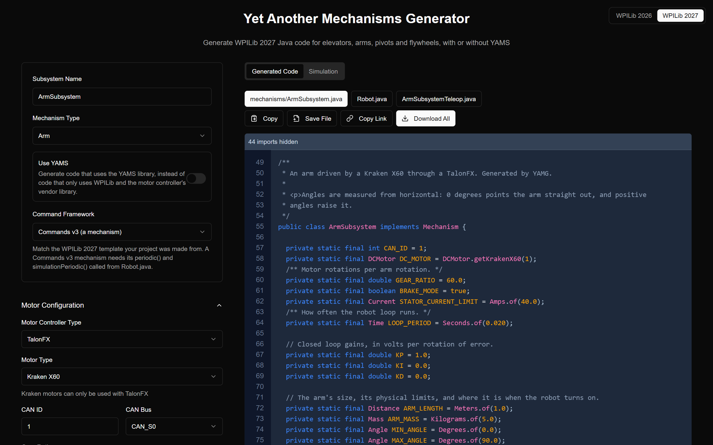
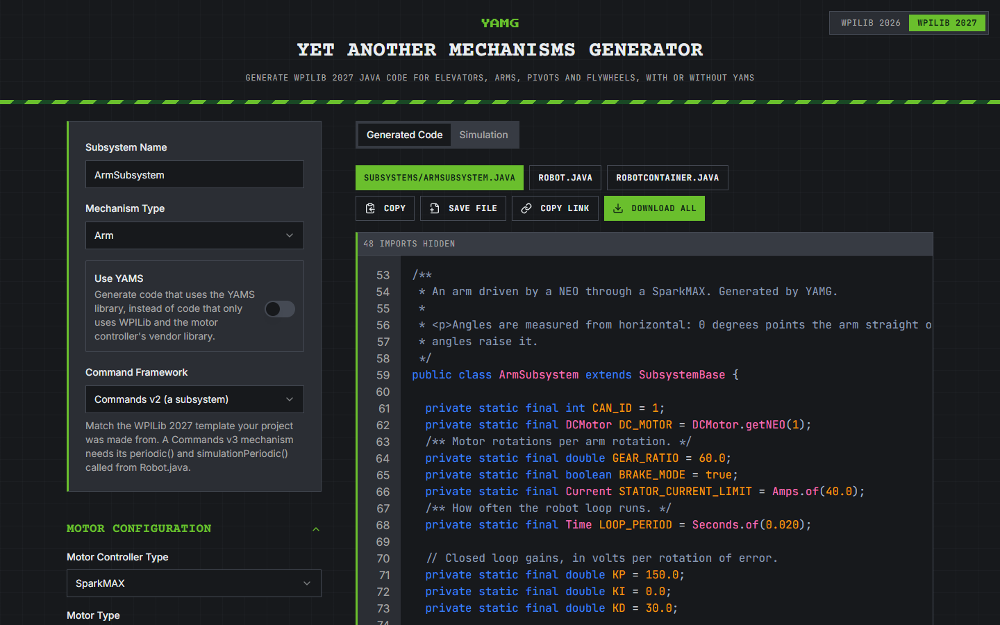
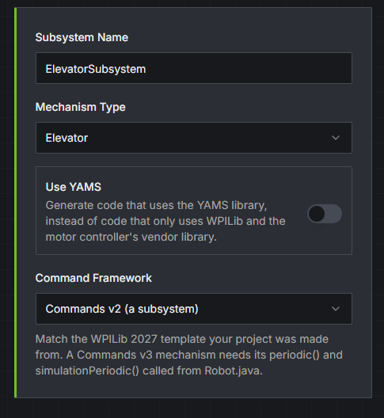
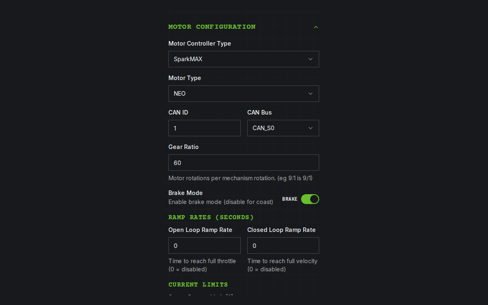
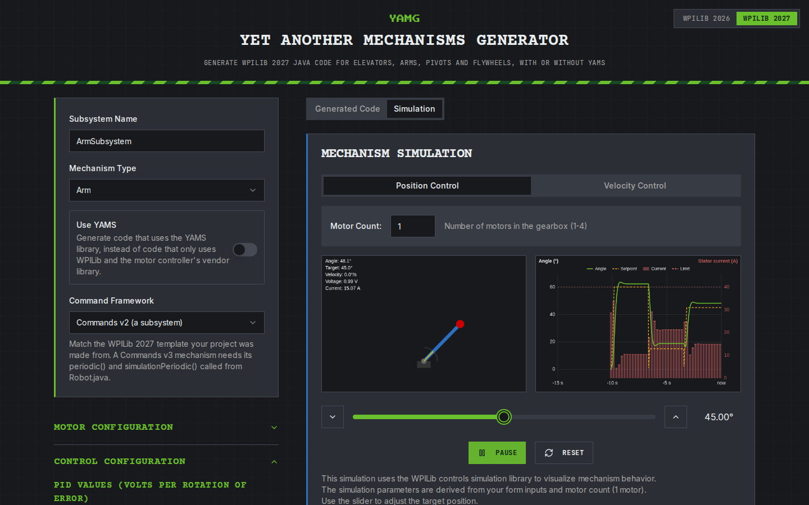
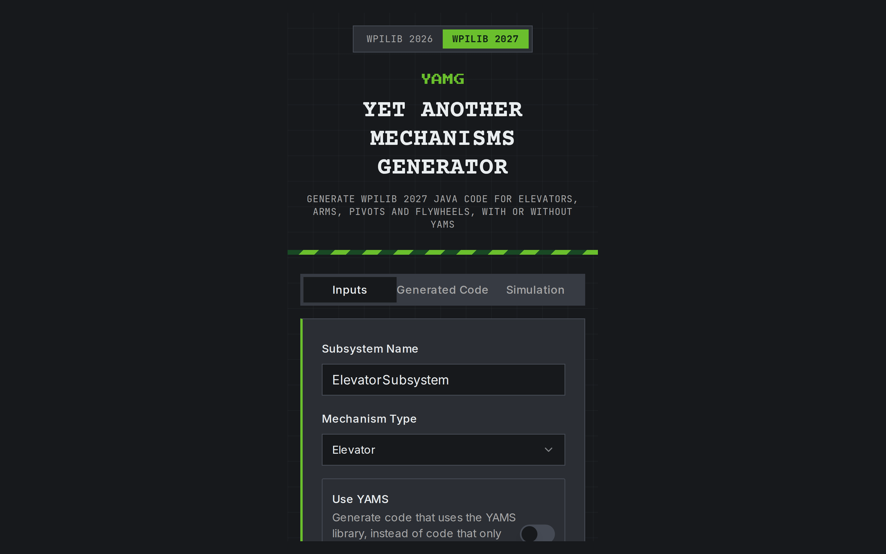

## Before and after

Here's how it looked last week, in the [YAMG 2027 post](/blog/yamg-2027):

[YAMG](https://yamg.yassrobotics.com) (Yet Another Mechanisms Generator) has been restyled to match this website. It now looks like the rest of YASS.

The code it generates is the same as before. What has changed is where the form starts: each mechanism now starts with firm PID gains and a gear ratio that suits it. See [New starting values](#new-starting-values) below.

## A form that's easier to scan

 Every section (Motor Configuration, Control Configuration, Telemetry, Homing, etc) and every group inside one (Ramp Rates, Current Limits, PID Values, Feedforward and so on) has a green heading, larger than the field labels under it. At the top of the form, where you name the mechanism and pick its type can be identified by a green stripe on the left side of the box. 

## Brake or coast

The brake mode switch now says what it does. It reads **Brake** when it's on and **Coast** when it's off, so you don't have to remember which way round it goes:

## The code and the simulation

Simulation has the new colors too. On the graph, the measured angle (or height, or speed) is green, the setpoint is yellow and the stator current is red. The mechanism's current and target markers match the graph. Here a NEO at 60:1 moves an arm to 60°, down to 15° and back up to 45°:

## New starting values

YAMG used to start every mechanism at a kP of 1 on a 15:1 gearbox. A kP of 1 barely moves an elevator, which made a normal kP of 50 look like a mistake. 15:1 was also wrong for two mechanisms: one motor couldn't lift the default arm, and the flywheel topped out near 400 RPM.

Each mechanism now has its own starting values. Each one was checked in YAMG's simulation:

| Mechanism | Gear ratio | kP | kD | In the simulation |
|---|---|---|---|---|
| Elevator | 15:1 | 50 V/m | 0 | 0.8 m in about 1.2 s, no overshoot |
| Arm | 60:1 | 150 V/rot | 30 | 60° in about 1.7 s, within 2% |
| Pivot and turret | 15:1 | 50 V/rot | 20 | 60° in about 1.4 s, no overshoot |
| Flywheel | 1:1 | 5 V/(rot/s) | 0 | holds 3000 RPM within 3% |

The default arm is also lighter, at 3 kg instead of 5.

When you change the mechanism type, the gains and gear ratio switch to that mechanism's starting values, unless you've already changed them.

These are starting points, not a tuned mechanism. Without feedforward, an arm sags a little below its target and a flywheel runs a little under its setpoint. Add kG for the arm and kV for the flywheel to close the gap. The **Open ReCalc** button can work out an arm's or elevator's feedforward for you.

Share links only store what differs from the starting values. A link made before this change that kept the old kP of 1 or the old gear ratio will now open with the new ones.

## On your phone

The phone layout is the same as before, with the inputs, the code and the simulation on their own tabs, in the new look:

## Still on 2026?

The 2026 version at [yamg.yassrobotics.com/2026](https://yamg.yassrobotics.com/2026/) keeps its old look for now. Use the WPILib 2026 / 2027 switch in the top corner to swap between them.

## Feedback

YAMG is open source: [github.com/Yet-Another-Software-Suite/yamg](https://github.com/Yet-Another-Software-Suite/yamg). If something is hard to read or find in the new look, open an issue, or tell us on the [YASS Discord](https://discord.gg/yass).
