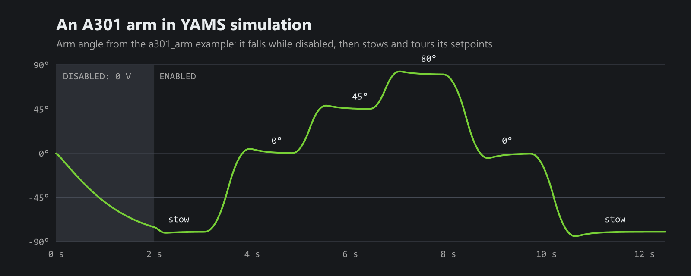

[YAMS v2026.11.05](https://github.com/Yet-Another-Software-Suite/YAMS/releases/tag/v2026.11.05) is out. It's the fourth release since [YAMS and YAGSL became ready for 2027 alpha 7](/blog/yams-yagsl-2027-alpha7), and the biggest news is the **FIRST A301**: YAMS now drives it like every other motor controller.



That chart is the new `a301_arm` example running in simulation. While the robot is disabled, the arm gets no power and falls. Once enabled, it stows at -80°, then the autonomous swings it to 0°, 45°, 80° and back, and stows it again.

## The A301Wrapper

The A301 is FIRST's new smart motor. It has no closed loop gains of its own, so the `A301Wrapper` runs the closed loop on the SystemCore and sends the A301 a voltage. You still write the same YAMS config as for a TalonFX or a SPARK: a PID, a motion profile, a feedforward and your gearing.

```java
SmartMotorController motor = new A301Wrapper(
    new A301(CANPorts.fromBusId(1), 20),
    new SmartMotorControllerConfig(this)
        .withControlMode(ControlMode.CLOSED_LOOP)
        .withClosedLoopController(30, 0, 0)
        .withTrapezoidalProfile(DegreesPerSecond.of(180), DegreesPerSecondPerSecond.of(360))
        .withFeedforward(new ArmFeedforward(0, 1.6, 10.2, 0))
        // From the A301's rotor to the arm: its 64:1 gearbox, then a 3:1 chain.
        .withGearing(new MechanismGearing(GearBox.fromReductionStages(64, 3)))
        .withZeroPower(MotorMode.BRAKE)
        .withTelemetry("ArmMotor", TelemetryVerbosity.HIGH));
```

A few things to know:

- **Your gearing includes the A301's gearbox**, whichever one you picked: 135:1, 64:1, 36:1, 27:1, 13.5:1 or 3:1.
- **Its absolute encoder is on the output shaft.** Pass the A301 itself to `withExternalEncoder` to use it.
- **No `DCMotor` needed.** The wrapper uses `YMotors.getA301(1)`: 13,500 RPM free and 0.078 Nm stalled at 12 V. FIRST hasn't published the A301's currents yet, so until then it uses the NEO 550's.
- **The A301 has no current limits, ramp rates, voltage compensation, vendor config or followers.** If you configure any of them, YAMS throws a `SmartMotorControllerConfigurationException` instead of silently ignoring it.
- **C++ too.** It's `yams/motorcontrollers/local/A301Wrapper.hpp`, and the A301's motor is `YMotors::A301()`.

The [A301Wrapper reference](https://yams.yassrobotics.com/api-reference/java-reference/motor-controllers/a301-wrapper) has every option. It needs REVLib `2027.0.0-alpha-9`.

## New arm examples

Every release now has its example robots attached as zips, each with that release's vendordep already installed. Four of them are new arms:

| Example | Motor | Commands v2 | Commands v3 |
| --- | --- | --- | --- |
| A301 Arm | A301 through 64:1 and a 3:1 chain | [example-a301_arm.zip](https://github.com/Yet-Another-Software-Suite/YAMS/releases/download/v2026.11.05/example-a301_arm.zip) | [example-commands3-a301_arm.zip](https://github.com/Yet-Another-Software-Suite/YAMS/releases/download/v2026.11.05/example-commands3-a301_arm.zip) |
| Nova Arm | NEO on a Thrifty Nova, through 25:1 | [example-nova_arm.zip](https://github.com/Yet-Another-Software-Suite/YAMS/releases/download/v2026.11.05/example-nova_arm.zip) | [example-commands3-nova_arm.zip](https://github.com/Yet-Another-Software-Suite/YAMS/releases/download/v2026.11.05/example-commands3-nova_arm.zip) |

Both arms use the same controls. Hold **A** for 0°, **B** for 45° or **Y** for 80°, and let go to stow. Autonomous tours every setpoint, so you can watch it move without a controller. Open one in WPILib VS Code and run **WPILib: Simulate Robot Code**.

The Commands v3 versions use opmodes: an `Arm Teleop` with the bindings, and an `Arm Tour` autonomous. The tour holds the arm at each angle until it has settled there, then moves on:

```java
for (Angle angle : new Angle[] {LEVEL, HIGH, UP, LEVEL, STOW}) {
  coroutine.awaitAny(robot.arm.setAngle(angle), robot.arm.settleAt(angle));
}
```

Each arm example also has a test that runs the robot in simulation and checks that the arm reaches every setpoint, so you can see how to test your own mechanisms.

Also new since alpha 7: `double_flywheel`, two flywheels in one subsystem tuned with one Live Tuning command, and `lqr_mechanisms`, an arm and a flywheel run by LQRs.

## Breaking changes

Most of these only need a find and replace, but check the gains of anything on a SPARK or a Nova. The [migration guide](https://github.com/Yet-Another-Software-Suite/YAMS/blob/master/MIGRATION.md#updating-from-v20261015-to-v20261103) has the details for each release.

**v2026.11.05**

- **Discontinuity points are replaced by wrapping.** `withExternalEncoderDiscontinuityPoint(...)` is removed. Use `withWrapping(min, max)` for the range your absolute encoder reads, or `withContinuousWrapping(min, max)` if the closed loop should also take the shortest path, like a turret or a swerve azimuth.

  ```java
  // Before
  .withExternalEncoderDiscontinuityPoint(Rotations.of(0.5))

  // After: the encoder reads [-0.5, 0.5) rotations
  .withWrapping(Rotations.of(-0.5), Rotations.of(0.5))
  ```

  Each motor controller only accepts ranges its encoder can read, and throws if you give it another one.
- `getContinuousWrapping()` and `getContinuousWrappingMin()` are now `getWrappingMax()` and `getWrappingMin()`.
- **Continuous wrapping and soft limits can't be used together**, in either order. Java used to accept soft limits set after continuous wrapping. Plain `withWrapping` and soft limits are fine together.
- **The Thrifty Nova runs its own closed loop now** (see below), so gains tuned with the loop on the SystemCore need tuning again. A feedforward on the Nova needs a trapezoidal profile, only `SLOT_0` and `SLOT_1` exist, and mechanism limits need both an upper and a lower limit.
- **Update REVLib to `2027.0.0-alpha-9` and ThriftyLib to `2027.0.0-alpha-6`.**

**v2026.11.03**

- **Flash your SPARK MAX and SPARK Flex to firmware 27.0.0**, then check their gains. Followers no longer run about 1% slower than their leader, and kS no longer turns the motor at a velocity setpoint of 0.
- **The `SwerveDrive` Live Tuning command moved** to `Tuning/<name>/Live Tuning`, like every other mechanism's. Move any dashboard button that starts it. It also requires the drive now, so the default drive command pauses while it runs.
- **`runTo(Supplier, tolerance)` follows the supplier.** It used to read the supplier once, when the command was made.
- **`SmartMotorControllerConfig.clone()` is a deep copy.** Motors cloned from one config used to share its PID controller, so tuning one tuned them all.
- **C++:** `LQRConfig::GetLoop()` returns a `LQRConfig::LoopBundle`.

**v2026.10.19**

- **`getRelativeMechanismPosition()` is replaced by `getPose3d()`** on every mechanism (see below). The old one threw a `NullPointerException` on the robot.
- **C++:** `MechanismPositionConfig` is now the class that places a mechanism in 3D, as in Java.

## The Thrifty Nova runs its own closed loop

A Nova now runs the PID, the trapezoidal profile and the feedforward on the motor controller, including kG with cosine gravity for an arm, the same way a TalonFX or a SPARK does. You give YAMS the same gains in the same units, and YAMS sets up the Nova's slots, soft limits and wrapping for you. An LQR, an exponential profile or a velocity profile still runs on the SystemCore. In simulation the Nova runs its closed loop just like the real one, so the `nova_arm` example behaves in sim the way it would on a robot.

## The simulation acts like a robot

Three fixes make the simulation look the way a robot does:

- **A disabled robot's motors get no power.** Before, a simulated arm held its last voltage while disabled, so it held itself up. Now it falls, for every motor controller, like in the chart above.
- **No jump when you enable.** While disabled, the closed loop follows the mechanism, so when you enable it starts from where the arm actually is, not from where it was before it fell.
- **The Mechanism2d moves.** Each mechanism's Mechanism2d in the sim GUI stood still in 2027, because it was only logged once. Now it's logged on every update.

## Other new things worth trying

- **Put your mechanisms on a 3D robot model.** `getPose3d()` gives a mechanism's pose relative to the robot, from its motor's position, so it works on the robot and in sim. Mount an arm on an elevator with `MechanismPositionConfig.withParent(elevator::getPose3d)`, and give an elevator its stages with `withStages(...)` to see each stage move. See [How do I show my mechanisms on a 3D robot model?](https://yams.yassrobotics.com/documentation/how-to-simulation-and-logging/how-do-i-show-my-mechanisms-on-a-3d-robot-model)
- **Live tune an LQR.** A mechanism with an LQR publishes its LQR values in place of kP, kI and kD, and changing one rebuilds the LQR without a jump. See [LQR controllers](https://yams.yassrobotics.com/documentation/understanding/lqr-controllers).
- **Drive a motor at a voltage from Live Tuning.** Turn on `voltage/enabled` and set `voltage/setpoint` to check a motor's direction or find kS and kG by hand. Swerve modules can do it too, and the [YAGSL config generator's](https://config.yagsl.com) Live mode uses it to work out your drive gains. See [Live Tuning](https://yams.yassrobotics.com/documentation/how-to-tuning/live-tuning).
- **`withWheelMomentOfInertia(diameter, mass)`** for wheels and flywheels. `withMomentOfInertia(length, mass)` is for arms, and gives about 3 times too much for a wheel.
- **The Thrifty Pulsar** is supported on a TalonFXS, with `YMotors.getThriftyPulsar(1)`.
- **Every motor controller gives the same voltage for the same gains.** The SPARK MAX, SPARK Flex, TalonFX, TalonFXS and Thrifty Nova are tested against each other, so gains tuned on one carry over when you swap to another.

The full list of changes for every release is in the [changelog](https://yams.yassrobotics.com/changelog).

## Updating

If you installed YAMS from the WPILib Vendor Dependencies manager, update it there. The URLs pinned to this release are `https://cdn.yassrobotics.com/yams_commands2-2026.11.05.json` and `https://cdn.yassrobotics.com/yams_commands3-2026.11.05.json`. Then work through the breaking changes above for the releases you skipped.

If you get an A301 in your hands, try the `a301_arm` example and tell us how it goes. Bugs go on [YAMS issues](https://github.com/Yet-Another-Software-Suite/YAMS/issues), and questions, and anything you build, go on the [YASS Discord](https://discord.gg/yass).
