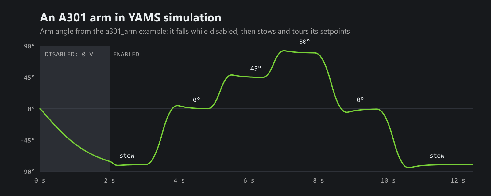

The [FIRST A301](https://www.firstinspires.org/community-blog/introducing-the-first-a301) is FIRST's new smart motor, and YAMS now drives it like any other motor controller. Arms, elevators, pivots and flywheels all work with it, with the same simulation, telemetry and live tuning as a TalonFX or a SPARK. For everything else that's new, see [What's new in YAMS since alpha 7](/blog/yams-whats-new).



That chart is the new `a301_arm` example running in simulation. While the robot is disabled, the arm gets no power and falls. Once enabled, it stows at -80°, then the autonomous swings it to 0°, 45°, 80° and back, and stows it again.

## How YAMS runs an A301

The A301 has no closed loop gains of its own. So the `A301Wrapper` runs the PID, the motion profile and the feedforward (or an LQR) on the SystemCore, and sends the A301 a voltage every loop. You don't have to do anything different for that: you write the same YAMS config you would for any other motor controller, with gains in the same units.

```java
SmartMotorController motor = new A301Wrapper(
    new A301(CANPorts.fromBusId(1), 20),
    new SmartMotorControllerConfig(this)
        .withControlMode(ControlMode.CLOSED_LOOP)
        .withClosedLoopController(30, 0, 0)
        .withTrapezoidalProfile(DegreesPerSecond.of(180), DegreesPerSecondPerSecond.of(360))
        .withFeedforward(new ArmFeedforward(0, 1.6, 10.2, 0))
        // From the A301's rotor to the arm: its 64:1 gearbox, then a 3:1 chain.
        .withGearing(new MechanismGearing(GearBox.fromReductionStages(64, 3)))
        .withZeroPower(MotorMode.BRAKE)
        .withTelemetry("ArmMotor", TelemetryVerbosity.HIGH));
```

There's no `DCMotor` to pass, since every A301 has the same motor. Give the result to an `Arm`, `Elevator`, `Pivot` or `FlyWheel` as usual.

In C++, include `<yams/motorcontrollers/local/A301Wrapper.hpp>`, and pass it the A301 and your config:

```cpp
first::a301::A301 a301{wpi::CANPort::CAN_S0, 20};
yams::motorcontrollers::local::A301Wrapper motor{&a301, &config};
```

## Things to know

- **Your gearing includes the A301's gearbox.** YAMS can't tell which one you bolted on, so enter it: 135:1, 64:1, 36:1, 27:1, 13.5:1 or 3:1, then anything after it.
- **Plan for a big reduction.** The A301 peaks at about 28 W, much less than a NEO. The example's 18 in, 2 lb arm uses the 64:1 gearbox and a 3:1 chain, 192:1 in total.
- **Its absolute encoder is on the output shaft.** Pass the A301 itself to `withExternalEncoder` to close the loop on it. Its gearing is from the output shaft to the mechanism, so it leaves out the gearbox. Without a starting position, YAMS seeds the relative encoder from it when the robot starts.
- **The motor model.** WPILib has no model of the A301 yet, so YAMS has `YMotors.getA301(1)`: 13,500 RPM free and 0.078 Nm stalled at 12 V, from FIRST's numbers. FIRST hasn't published its currents, so until then it uses the NEO 550's.
- **What it doesn't have.** The A301 has no current limits, ramp rates, voltage compensation, vendor config or follower mode. If you configure any of them, YAMS throws a `SmartMotorControllerConfigurationException`, so you find out right away instead of on the field. To drive two A301s together, use `withLooselyCoupledFollowers`.
- **It doesn't report its supply current.** In simulation you get the simulated value; on the robot that telemetry isn't published.

The [A301Wrapper reference](https://yams.yassrobotics.com/api-reference/java-reference/motor-controllers/a301-wrapper) has every option. It needs REVLib `2027.0.0-alpha-9`.

## Simulation

REVLib doesn't simulate the A301, so YAMS does. The wrapper simulates the A301's motor with the moment of inertia and gearing from your config, adds its current draw to the robot's simulated battery, and moves the absolute encoder with the simulated mechanism. Set `withMomentOfInertia(...)` to something close to your mechanism, and the current draw will be close too.

Like every other motor controller in YAMS, a disabled A301 gets no power in simulation, so an arm falls instead of holding itself up. When you enable it again, the closed loop starts from where the arm is, without a jump.

## Try the example

The `a301_arm` example is attached to the [latest release](https://github.com/Yet-Another-Software-Suite/YAMS/releases/tag/v2026.11.05), in both command frameworks, with the vendordep already installed:

- **Commands v2:** [example-a301_arm.zip](https://github.com/Yet-Another-Software-Suite/YAMS/releases/download/v2026.11.05/example-a301_arm.zip)
- **Commands v3:** [example-commands3-a301_arm.zip](https://github.com/Yet-Another-Software-Suite/YAMS/releases/download/v2026.11.05/example-commands3-a301_arm.zip)

Extract it, open the folder in WPILib VS Code, and run **WPILib: Simulate Robot Code**. Hold **A** for 0°, **B** for 45° or **Y** for 80°, and let go to stow. Autonomous tours every setpoint, so you can watch it move without a controller.

The Commands v3 version uses opmodes: an `Arm Teleop` with the bindings, and an `Arm Tour` autonomous that holds the arm at each angle until it has settled there, then moves on:

```java
for (Angle angle : new Angle[] {LEVEL, HIGH, UP, LEVEL, STOW}) {
  coroutine.awaitAny(robot.arm.setAngle(angle), robot.arm.settleAt(angle));
}
```

Both versions come with a test that runs the robot in simulation and checks that the arm holds every setpoint within 3°. It's a good starting point for testing your own mechanisms.

## Tell us how it goes

If you get an A301 in your hands, try the example on it and tell us how it goes, especially how close the simulation is to the real thing. Bugs go on [YAMS issues](https://github.com/Yet-Another-Software-Suite/YAMS/issues), and questions, and anything you build, go on the [YASS Discord](https://discord.gg/yass).
