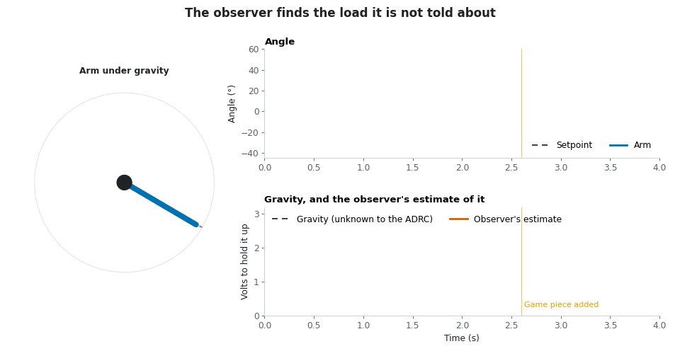
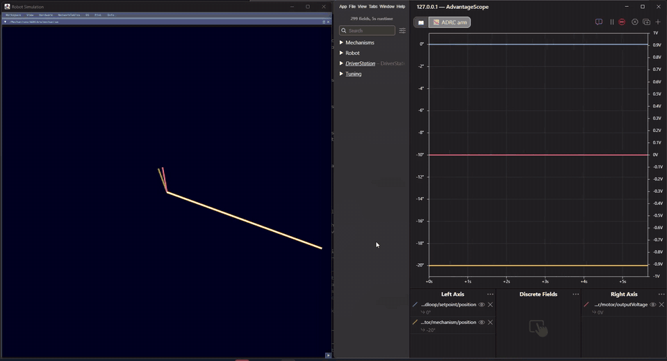

YAMS has a new closed loop controller: **ADRC**, short for Active Disturbance Rejection Control. It takes the place of a PID and its feedforward, and you tune it with one number: how quickly the mechanism should reach its setpoint.

The math isn't ours. **[FRC Team 8331](https://www.instagram.com/cgss.robotics/), Carson Graham Robotics from North Vancouver, wrote it** in their fork of YAMS and contributed it back.


## Thank you, 8331

All of the math in YAMS's ADRC is 8331's: the controller, the extended state observer and the tracking differentiator. We took what they gave us, reworked the API to fit the rest of YAMS, wired it into every motor controller, simulation, telemetry and live tuning, and ported it to C++. The C++ version runs the same math as theirs.

YAMS is built by teams for teams, and this is the best kind of contribution: a team solved a problem on their own robot and made it so every other team can use it too. Thank you, 8331. Go give them a follow on [Instagram](https://www.instagram.com/cgss.robotics/).

## What an ADRC does

A PID only reacts to error, so a mechanism needs a feedforward to hold it up and move it smoothly: kG for gravity, kS for friction, kV and kA for the motor. Each one has to be measured or tuned, and each is wrong as soon as the robot picks up a game piece.

An ADRC doesn't need them. It treats everything it isn't told about (gravity, friction, back-EMF, a game piece, a defender leaning on your arm) as one **total disturbance**. An extended state observer estimates that disturbance every loop from how the mechanism moves, and the controller cancels it.



That arm is never told about gravity or the game piece. The observer (red) finds the volts gravity takes within about 0.1 s, and catches up when a game piece lands on the end of the arm, while the arm dips half a degree.

## Setting one up

`withADRCController(...)` replaces `withClosedLoopController(kP, kI, kD)` and `withFeedforward(...)` on the motor config:

```java
new SmartMotorControllerConfig(this)
    .withControlMode(ControlMode.CLOSED_LOOP)
    .withGearing(new MechanismGearing(60))
    .withMomentOfInertia(Meters.of(0.5), Kilograms.of(3)) // b0 is derived from this
    .withClosedLoopControllerMaximumVoltage(Volts.of(12))
    .withADRCController(new ADRCConfig()
        .withSystemOrder(SystemOrder.ARM)
        .withSettlingTime(Seconds.of(0.3)));
```

Your mechanism doesn't change. An `Arm`, `Elevator`, `Pivot` or `FlyWheel` keeps calling `setPosition` and `setVelocity`, and the motor controller runs the ADRC.

- **Pick the system order.** `ARM`, `PIVOT` or `ELEVATOR` for a position loop, and `FLYWHEEL` for a velocity loop.
- **Set the moment of inertia.** YAMS uses it, with the motor and gearing, to work out `b0`, how strongly a volt moves the mechanism. You rarely need to set `b0` yourself.
- **Set the settling time.** Start around 0.5 s for a position loop and 0.3 s for a velocity loop, and shorten it while each move gets faster and stays clean.
- **Set a voltage limit.** Always set `withClosedLoopControllerMaximumVoltage`. A short settling time drives the output to the limit at the start of every move, and the ADRC has no limit of its own, so without one it applies whatever the battery has. 12 V, as in the examples, gives you the same moves on a fresh battery and a tired one. The first time you run a mechanism on the robot, start lower, around 6 V, so a wrong setting can't slam it, then raise it once it behaves. A lower limit also makes the mechanism slower, so give it a longer settling time to match: if the output sits at the limit for most of a move, a shorter settling time only adds overshoot.



That's the example arm: a NEO on a 60:1 reduction moving a 3 kg, 0.5 m arm, with a 0.3 s settling time. It reaches each setpoint in about a third of a second without overshooting, and there isn't a single feedforward gain in its config.

## Things to know

- **It works everywhere.** The ADRC runs on the SystemCore, like an LQR, so it works with the SPARK MAX, SPARK Flex, TalonFX, TalonFXS, Thrifty Nova and A301, in Java and C++.
- **Position loops pick their own form.** A heavily geared arm moves at a speed set by its motor's back-EMF, and a lightly geared one is set by its inertia. They need different controllers, so YAMS works out which one your mechanism is when the controller is built. The wrong one works badly: run the other way, a 60:1 pivot overshoots a 135° step by 77°.
- **It knows what the motor actually did.** The observer is told the voltage the motor controller applied, not the one it asked for, so a current limit or a low battery isn't mistaken for a disturbance.
- **Ramps are the same as before.** `withClosedLoopRampRate` ramps an ADRC's output like any other closed loop. Leave it off unless the mechanism needs it: a ramp slows the response and adds overshoot.
- **Motion profiles work.** Add a trapezoidal or exponential profile as usual, and the ADRC follows it.
- **You can live tune it.** With `HIGH` telemetry, `b0`, the settling time and the bandwidth scale show up in place of kP, kI and kD, and a change takes effect on the next loop without the output jumping.

## Try it

The `adrc_mechanisms` example has an arm, an elevator and a shooter, each run by an ADRC. It's attached to the [latest release](https://github.com/Yet-Another-Software-Suite/YAMS/releases/tag/v2026.11.14):

- **Commands v2:** [example-adrc_mechanisms.zip](https://github.com/Yet-Another-Software-Suite/YAMS/releases/download/v2026.11.14/example-adrc_mechanisms.zip)
- **Commands v3:** [example-commands3-adrc_mechanisms.zip](https://github.com/Yet-Another-Software-Suite/YAMS/releases/download/v2026.11.14/example-commands3-adrc_mechanisms.zip)

Extract it, open the folder in WPILib VS Code, and run **WPILib: Simulate Robot Code**.

To set one up on your own mechanism, start with [How do I use ADRC instead of PID?](https://yams.yassrobotics.com/documentation/how-to-tuning/how-do-i-use-adrc), and read [ADRC controllers](https://yams.yassrobotics.com/documentation/understanding/adrc-controllers) for how it works.

If you try it on a real robot, tell us how it goes on the [YASS Discord](https://discord.gg/yass), and file bugs on [YAMS issues](https://github.com/Yet-Another-Software-Suite/YAMS/issues).
