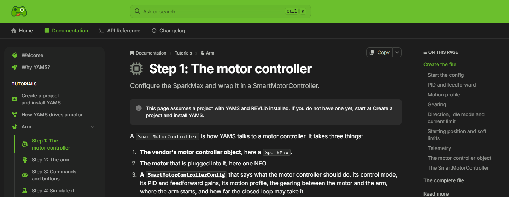
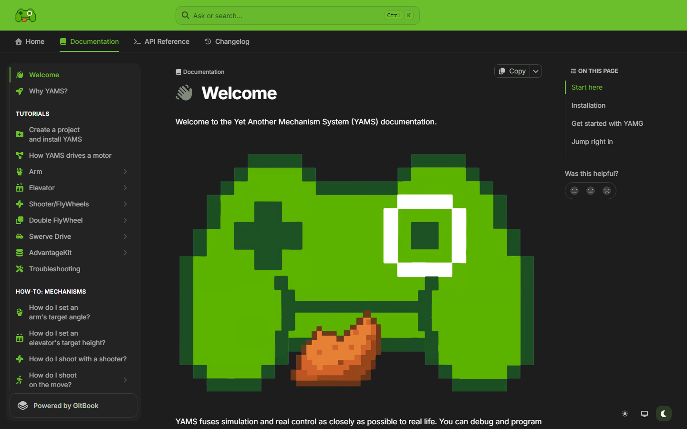
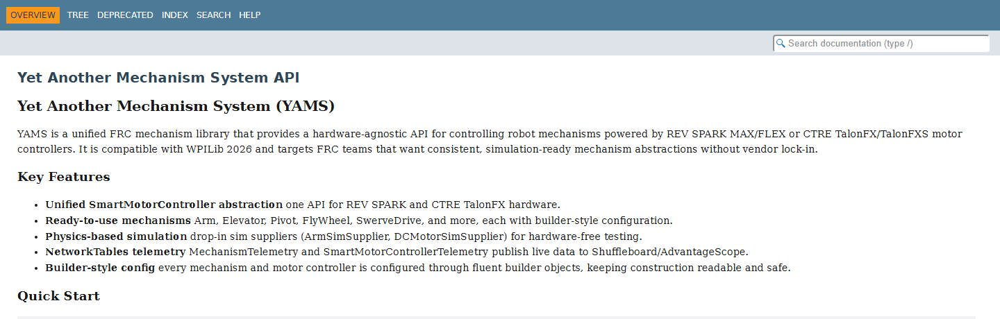

The [YAMS documentation](https://yams.yassrobotics.com/documentation) has been restyled to match this website, [YAMG](/blog/yamg-new-look) and the [YAGSL config generator](/blog/yagsl-config-new-look). The Java API reference has a new address too.

## The new look

- **Colours:** a Bright Fern green header, dark graphite pages, and green for links, the page you're on and the section you're reading.
- **The logo:** the YAMS pixel controller, in the header and on the welcome page.
- **An icon for every page**, so Tutorials and How-to look like Understanding and Reference, and you can spot a page in the sidebar at a glance.
- **Light, dark or your system's theme**, from the buttons in the bottom corner.
- **The same four tabs on every page:** Home, Documentation, API Reference and Changelog.

## A clearer path through the tutorials

The look isn't the only change. We read through the docs as a new reader would, and fixed what they'd trip on:

- **Every tutorial is a numbered path.** The Arm tutorial goes from the motor controller, to the arm, to commands and buttons, then **Simulate it**, **Tune it** and **Run it on the robot**. The steps inside each page are shown as a stepper, so you can see where you are.
- **Tune it with the YAMS Live Tuner.** The arm, elevator, flywheel, double flywheel and swerve tutorials each have a tuning step, with screenshots of the Live Tuner on that tutorial's own mechanism.
- **"In a hurry?"** The tutorial steps link straight to their complete file, so you can copy it and change only the values marked **For your robot**.
- **Java, Commands v2 or v3, or C++.** Code is in tabs, so you only read the version you write.
- **A Troubleshooting page** for when something doesn't move the way you expect.

## The Javadocs moved

The Java API reference is now at:

**[javadocs.yassrobotics.com/yams](https://javadocs.yassrobotics.com/yams/)**

It used to be at `yet-another-software-suite.github.io/YAMS/javadocs`. Update your bookmarks and any links in your team's code or notes. Every link in the docs already points to the new address.

The C++ API reference, made with Doxygen, has its own address too: **[doxygen.yassrobotics.com/yams](https://doxygen.yassrobotics.com/yams/)**.

YAGSL's Javadocs moved the same way, to **[javadocs.yassrobotics.com/yagsl](https://javadocs.yassrobotics.com/yagsl/)**.

You can also reach all of these from the project cards on the [YASS homepage](/), and from the API Reference tab in the docs, which lists the Java and C++ references at the top of its sidebar.

## Tell us what you think

If a page is confusing, a link is broken, or something looks wrong in light or dark mode, tell us with the **Was this helpful?** buttons on the page, on [YAMS issues](https://github.com/Yet-Another-Software-Suite/YAMS/issues), or on the [YASS Discord](https://discord.gg/yass).
