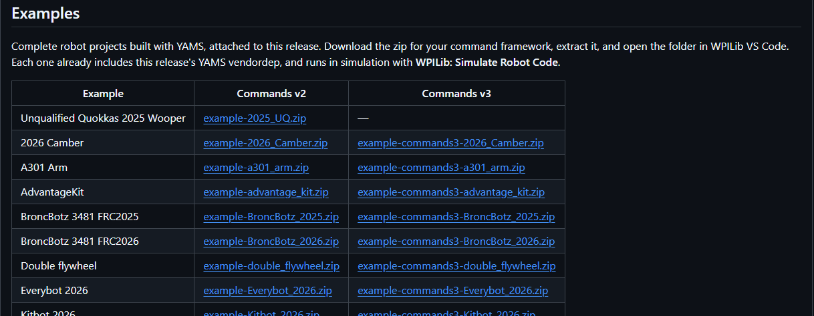

YAMS has had a lot of updates since [YAMS and YAGSL became ready for 2027 alpha 7](/blog/yams-yagsl-2027-alpha7). Here are the new things worth trying, every breaking change to look out for when you update, and the bugs we fixed. The [changelog](https://yams.yassrobotics.com/changelog) has the full list, release by release.



## The FIRST A301

YAMS now drives FIRST's A301 smart motor with the new `A301Wrapper`, in Java and C++. It has [its own post](/blog/yams-a301-wrapper), with how to set one up and an arm example you can run in simulation.

## The Thrifty Nova runs its own closed loop

A Nova now runs the PID, the trapezoidal profile and the feedforward on the motor controller, including kG with cosine gravity for an arm, the same way a TalonFX or a SPARK does. You give YAMS the same gains in the same units, and YAMS sets up the Nova's slots, soft limits and wrapping for you. In simulation the Nova runs its closed loop just like the real one.

- **A feedforward doesn't need a motion profile.** YAMS gives the Nova your kS, kV, kA and kG either way, so a swerve drive motor or a flywheel keeps its whole feedforward on the Nova.
- **Continuous wrapping works over any range**, such as [-0.5, 0.5). With an absolute encoder plugged into the Nova, the Nova wraps it itself. On the Nova's own motor encoder, YAMS sends each target the short way round, so a swerve azimuth seeded from a CANcoder runs entirely on the Nova, just like one on a SPARK MAX.
- **Anything the Nova can't do runs on the SystemCore** instead of throwing: an LQR, an exponential profile, a velocity profile, an absolute encoder read over a range other than [0, 1) without continuous wrapping, or continuous wrapping of an absolute encoder geared to the mechanism. `getClosedLoopControllerPeriod()` tells you where the loop runs: 1 ms on the Nova, or 20 ms on the SystemCore.

## New examples

Every release now has its example robots attached as zips, each with that release's vendordep already installed. Open one in WPILib VS Code and run **WPILib: Simulate Robot Code**. The new ones:

| Example | What it shows | Commands v2 | Commands v3 |
| --- | --- | --- | --- |
| A301 Arm | An arm on an A301, through its 64:1 gearbox and a 3:1 chain | [zip](https://github.com/Yet-Another-Software-Suite/YAMS/releases/download/v2026.11.05/example-a301_arm.zip) | [zip](https://github.com/Yet-Another-Software-Suite/YAMS/releases/download/v2026.11.05/example-commands3-a301_arm.zip) |
| Nova Arm | An arm on a NEO and a Thrifty Nova, through 25:1, with the loop on the Nova | [zip](https://github.com/Yet-Another-Software-Suite/YAMS/releases/download/v2026.11.05/example-nova_arm.zip) | [zip](https://github.com/Yet-Another-Software-Suite/YAMS/releases/download/v2026.11.05/example-commands3-nova_arm.zip) |
| Double flywheel | Two flywheels in one subsystem, tuned with one Live Tuning command | [zip](https://github.com/Yet-Another-Software-Suite/YAMS/releases/download/v2026.11.05/example-double_flywheel.zip) | [zip](https://github.com/Yet-Another-Software-Suite/YAMS/releases/download/v2026.11.05/example-commands3-double_flywheel.zip) |
| LQR mechanisms | An arm and a flywheel run by LQRs | [zip](https://github.com/Yet-Another-Software-Suite/YAMS/releases/download/v2026.11.05/example-lqr_mechanisms.zip) | [zip](https://github.com/Yet-Another-Software-Suite/YAMS/releases/download/v2026.11.05/example-commands3-lqr_mechanisms.zip) |

Both arms use the same controls: hold **A** for 0°, **B** for 45° or **Y** for 80°, and let go to stow. Autonomous tours every setpoint, so you can watch them move without a controller. Each arm also has a test that runs the robot in simulation and checks it reaches every setpoint.

## Other new things worth trying

- **Put your mechanisms on a 3D robot model.** `getPose3d()` gives a mechanism's pose relative to the robot, from its motor's position, so it works on the robot and in sim. Mount an arm on an elevator with `MechanismPositionConfig.withParent(elevator::getPose3d)`, and give an elevator its stages with `withStages(...)` to see each stage move. See [How do I show my mechanisms on a 3D robot model?](https://yams.yassrobotics.com/documentation/how-to-simulation-and-logging/how-do-i-show-my-mechanisms-on-a-3d-robot-model)
- **Live tune an LQR.** A mechanism with an LQR publishes its LQR values in place of kP, kI and kD, and changing one rebuilds the LQR without a jump. See [LQR controllers](https://yams.yassrobotics.com/documentation/understanding/lqr-controllers).
- **Drive a motor at a voltage from Live Tuning.** Turn on `voltage/enabled` and set `voltage/setpoint` to check a motor's direction or find kS and kG by hand. Swerve modules can do it too, and the [YAGSL config generator's](https://config.yagsl.com) Live mode uses it to work out your drive gains. See [Live Tuning](https://yams.yassrobotics.com/documentation/how-to-tuning/live-tuning).
- **`withWrapping(min, max)`** for an absolute encoder that has to read across zero, like an arm's, without making the closed loop take the shortest path.
- **`withWheelMomentOfInertia(diameter, mass)`** for wheels and flywheels. `withMomentOfInertia(length, mass)` is for arms, and gives about 3 times too much for a wheel.
- **The Thrifty Pulsar** is supported on a TalonFXS, with `YMotors.getThriftyPulsar(1)`.
- **Every motor controller gives the same voltage for the same gains.** The SPARK MAX, SPARK Flex, TalonFX, TalonFXS and Thrifty Nova are tested against each other, so gains tuned on one carry over when you swap to another.
- **The closed loop period** is published as `closedloop/period`, so you can see whether the loop runs on the motor controller or the SystemCore.

## Breaking changes

Most of these only need a find and replace, but check the gains of anything on a SPARK or a Nova. The [migration guide](https://github.com/Yet-Another-Software-Suite/YAMS/blob/master/MIGRATION.md) has the details.

**Update your vendordeps and firmware**

- **REVLib `2027.0.0-alpha-9` and ThriftyLib `2027.0.0-alpha-6`.**
- **Flash your SPARK MAX and SPARK Flex to firmware 27.0.0**, then check their gains. Followers no longer run about 1% slower than their leader, nor apply voltage compensation twice, and kS no longer turns the motor at a velocity setpoint of 0.

**Changes that need code changes**

- **Discontinuity points are replaced by wrapping.** `withExternalEncoderDiscontinuityPoint(...)` is removed. Use `withWrapping(min, max)` for the range your absolute encoder reads, or `withContinuousWrapping(min, max)` if the closed loop should also take the shortest path, like a turret or a swerve azimuth.

  ```java
  // Before
  .withExternalEncoderDiscontinuityPoint(Rotations.of(0.5))

  // After: the encoder reads [-0.5, 0.5) rotations
  .withWrapping(Rotations.of(-0.5), Rotations.of(0.5))
  ```

  Each motor controller only accepts ranges its encoder can read, and throws if you give it another one, except a Nova, which runs those on the SystemCore. Without wrapping, a SPARK or Nova absolute encoder reads [0, 1), and a CANcoder or CANdi keeps its own range.
- **`getContinuousWrapping()` and `getContinuousWrappingMin()` are now `getWrappingMax()` and `getWrappingMin()`.** `isWrappingContinuous()` says whether the closed loop wraps.
- **Continuous wrapping and soft limits can't be used together**, in either order. Java used to accept soft limits set after continuous wrapping. Plain `withWrapping` and soft limits are fine together.
- **When the Thrifty Nova runs the closed loop**, only `SLOT_0` and `SLOT_1` exist, mechanism limits need both an upper and a lower limit, and `withTemperatureCutoff`, `withClosedLoopControllerMaximumVoltage`, `withFeedbackSynchronizationThreshold` and `withClosedLoopControlPeriod` are rejected. Gains tuned with the loop on the SystemCore need tuning again.
- **`getRelativeMechanismPosition()` is replaced by `getPose3d()`** on every mechanism. The old one threw a `NullPointerException` on the robot, and turned the wrong way.
- **The `SwerveDrive` Live Tuning command moved** to `Tuning/<name>/Live Tuning`, like every other mechanism's. It was at `Mechanisms/<name>/tuning`. Move any dashboard button that starts it.
- **C++:** `MechanismPositionConfig` is now the class that places a mechanism in 3D, as in Java, and `ArmConfig`, `ElevatorConfig`, `PivotConfig` and `FlyWheelConfig` take one with `WithMechanismPositionConfig(...)`.
- **C++:** `LQRConfig::GetLoop()` returns a `LQRConfig::LoopBundle`.

**Changes in how things behave**

- **`runTo(Supplier, tolerance)` follows the supplier**, and ends once the mechanism has been near its current value for 0.1 s. It used to read the supplier once, when the command was made.
- **`SmartMotorControllerConfig.clone()` is a deep copy.** Motors cloned from one config used to share its PID controller, so tuning one tuned them all.
- **Setting a setpoint starts a stopped closed loop** that runs on the SystemCore, like an LQR or an exponential profile. A loop that's already running carries on, instead of restarting and losing an LQR's estimate or a PID's integral on every call.
- **Stopping a motor's closed loop stops its loosely coupled followers' too**, and starting it starts theirs.
- **The `SwerveDrive` Live Tuning command requires the drive**, so the default drive command pauses while it runs and comes back when it ends. Swerve live tuning only applies the values that changed, and a tuning mode that turns on turns off the ones it outranks.
- **A `Pivot`'s pose turns in the XY plane** by default, like a turret, unless you give it a `MechanismPositionConfig`. The C++ `PivotConfig` defaults to XY too, as in Java.
- **A TalonFXS drives a NEO Vortex as `VORTEX_JST`** rather than `NEO_JST`.
- **`LQRConfig.withAggressiveness` is deprecated.** It never changed anything; use qelms and relms.

## Bug fixes

**Simulation**

- **A disabled robot's motors get no power.** A simulated arm used to hold its last voltage while disabled, so it held itself up. Now it falls, for every motor controller.
- **No jump when you enable.** While disabled, the closed loop follows the mechanism, so when you enable it starts from where the mechanism is.
- **The Mechanism2d moves.** Each mechanism's Mechanism2d in the sim GUI stood still, because it was only logged once.
- **Simulated SPARKs follow their profile and feedforward**, start at their starting position, and report the voltage they really apply.
- **A Kraken X44 on a TalonFX is simulated as an X44**, not an X60, so an elevator no longer runs into its hard stop.
- **A simulated `Pivot` stops at its hard stops**, and starts at its starting position. A continuous one has no hard stops.
- **A simulated TalonFX or TalonFXS keeps an encoder position it's set to.**
- **A simulated CANdi reports its PWM position in the wrapping range**, as a real one does.
- **`BatterySim` is thread safe**, so mechanisms simulated in their own `Notifier`s no longer crash, and a mechanism no longer replaces the shared battery voltage.
- **C++:** a simulated LQR elevator brakes. The LQR used to read freed memory.

**Closed loops**

- **A closed loop no longer runs away** when a mechanism starts at the edge of its continuous wrapping range, such as at 0 with [0, 1) wrapping.
- **An LQR or exponential profile mechanism moves again after a duty cycle or voltage command**, such as a coasting default command. An LQR flywheel used to stay at 0 RPM in Live Tuning.
- **A loosely coupled follower stops when its leader does**, when its closed loop runs on the SystemCore.
- **A TalonFX's loosely coupled followers switch closed loop slot with it**, as the other motor controllers already did.
- **A Talon vendor config wins over the device's saved settings**, as in C++.
- **An elevator feedforward under velocity control on the SystemCore includes kV.**
- **`LQRConfig.withMeasurementDelay` compensates for the delay.** It used to be stored and never used.
- **`ExponentialProfilePIDController.createConstraints` and `createElevatorConstraints` return usable constraints**, instead of NaN or infinite ones.

**Everything else**

- **Live Tuning shows up** for an `Arm`, `Elevator`, `Pivot` or `FlyWheel` with `.withTelemetry(...)` in its mechanism config, and for `DifferentialMechanism` and `DoubleJointedArm` motors.
- **`SwerveInputStream` live tuning ignores a value left on the dashboard** by an earlier telemetry with the same name.
- **`DifferentialMechanism.set(...)` mixes its two outputs correctly.**
- **`withExternalEncoderGearing` warns the right way round**, when the encoder turns more than the mechanism and can wrap.
- **A TalonFXS no longer throws for a Thrifty Pulsar.**
- **C++ swerve** has the fixes Java already had, and azimuth live tuning.

## Updating

If you installed YAMS from the WPILib Vendor Dependencies manager, update it there, then work through the breaking changes above. The [latest release](https://github.com/Yet-Another-Software-Suite/YAMS/releases/tag/v2026.11.05) has the vendordep URLs and an offline installer.

Found something we missed? Bugs go on [YAMS issues](https://github.com/Yet-Another-Software-Suite/YAMS/issues), and questions, and anything you build, go on the [YASS Discord](https://discord.gg/yass).
