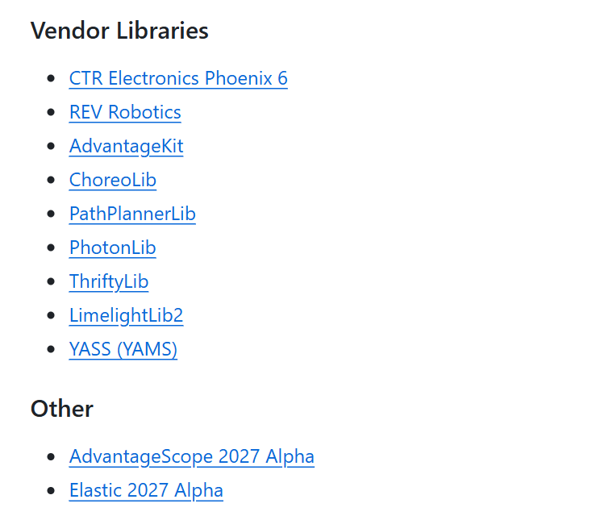
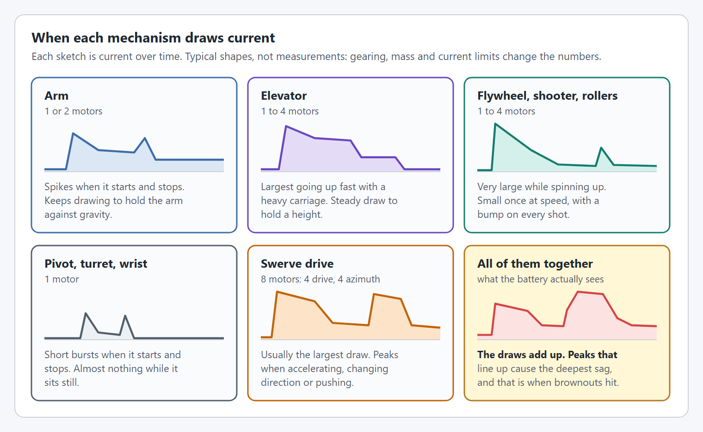
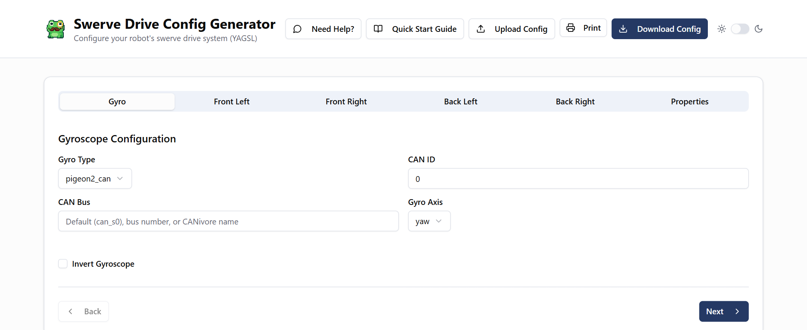

YAMS and YAGSL both run on WPILib 2027.0.0-alpha-7 and the SystemCore. They now have a page in WPILib's SystemcoreTesting repository, alongside the other vendor libraries teams are testing for 2027:

**[SystemcoreTesting/YASS.md](https://github.com/wpilibsuite/SystemcoreTesting/blob/main/YASS.md)**

That page is the place to start. It has the vendordep URLs, the current versions, the supported hardware, and migration notes for coming from 2026.

## Thank you, Limelight

A big thank you to the Limelight team for reviewing and merging [the pull request](https://github.com/wpilibsuite/SystemcoreTesting/pull/408) that added YASS to SystemcoreTesting. Being listed there next to Phoenix 6, REVLib, ThriftyLib and LimelightLib means teams testing the SystemCore can find YAMS and YAGSL in the same place as everything else, with instructions written for the alpha they're on.

## YAMS for 2027

[YAMS](https://yams.yassrobotics.com) (Yet Another Mechanism System) is our mechanism library. You describe an arm, elevator, pivot, flywheel, turret, differential mechanism, double jointed arm or swerve drive once, and YAMS gives you the commands, the physics simulation, the telemetry and live tuning. The current release for alpha 7 is [v2026.10.15](https://github.com/Yet-Another-Software-Suite/YAMS/releases/tag/v2026.10.15).

What's different in 2027:

- **One vendordep per command framework.** Install `yams_commands2.json` for Commands v2 (Java and C++), or `yams_commands3.json` for Commands v3 (Java). Install one or the other, not both.
- **A split API.** `yams.core` holds the mechanism state, simulation and telemetry, with no dependency on a command framework. Robot code imports from `yams.commands2` or `yams.commands3`, which add the `Command` and `Trigger` factories. Most 2026 code only needs new imports.
- **Served from our own CDN.** The vendordeps and libraries come from `cdn.yassrobotics.com`, including when you build, so YAMS works on school networks that block `github.io`.
- **Every SystemCore motor controller.** YAMS supports the TalonFX, TalonFXS, SPARK MAX, SPARK Flex and, new for 2027, the Thrifty Nova. The same gains in YAMS units give the same voltage on all of them, and we have tests that check it.
- **Simulation of the whole robot's battery.** Every mechanism draws from one simulated battery, so you can see a brownout coming before it happens on the field.

Along with that you get live tuning of gains, profiles and limits from a dashboard, trapezoidal and exponential profiles, LQR, absolute encoders, and EasyCRT for turrets that turn more than once.

While testing on alpha 7 we also found a few bugs in REVLib's SPARK simulation, and reported them in [SystemcoreTesting#425](https://github.com/wpilibsuite/SystemcoreTesting/issues/425). YAMS works around them, so simulated SPARKs follow their profile and feedforward the way a real one does.

## YAGSL for 2027

[YAGSL](https://docs.yagsl.com) (Yet Another Generic Swerve Library) is now built on YAMS. It reads your swerve JSON files and builds a YAMS `SwerveDrive` with the motors, encoders and gyro already configured. Driving, odometry, input streams and telemetry all come from YAMS, so YAGSL and your other mechanisms share the same simulation and telemetry. The current release for alpha 7 is [v2026.10.09](https://github.com/Yet-Another-Software-Suite/YAGSL/releases/tag/v2026.10.09).

- **Make your configuration at [config.yagsl.com](http://config.yagsl.com).** Fill in your gyro, modules and properties, then download the files. The Quick Start Guide walks you through a new project from scratch. The 2027 JSON format has changed, so regenerate your configuration instead of editing your 2026 files.
- **Every vendor's devices are optional.** Each YAGSL vendordep only requires the matching YAMS vendordep. Install REVLib, Phoenix 6, ReduxLib or ThriftyLib only if your robot uses them.
- **One way to name a CAN bus.** `canbus` is empty for `can_s0`, or `"1"` to `"4"` for the other SystemCore buses, whatever the vendor. CTRE devices can still name a CANivore.
- **The SystemCore's built in IMU** can be your gyro, with no vendordep at all.
- **The Thrifty Nova** is supported again, including an absolute encoder plugged into its data port.

## Play with it this offseason

Alpha 7 is the time to try 2027, not January. You don't need a SystemCore to start: YAMS and YAGSL simulate themselves, so you can build your mechanisms and swerve drive, drive them, and tune them in AdvantageScope from a laptop.

1. Install WPILib 2027.0.0-alpha-7, and make a new project from a 2027 template.
2. Add YAMS (and YAGSL if you run swerve) using the URLs in [YASS.md](https://github.com/wpilibsuite/SystemcoreTesting/blob/main/YASS.md).
3. Generate a mechanism with [YAMG](https://yamg.yassrobotics.com), or start from the [YAMS](https://github.com/Yet-Another-Software-Suite/YAMS/tree/master/examples) and [YAGSL](https://github.com/Yet-Another-Software-Suite/YAGSL/tree/main/examples) examples.
4. Run it in simulation, and break it.

If you're bringing a 2026 robot over, the [YAMS migration guide](https://github.com/Yet-Another-Software-Suite/YAMS/blob/master/MIGRATION.md) covers every change, and YASS.md has the highlights for YAMS and YAGSL.

Things will break, because it's an alpha. When they do, please tell us:

- Bugs in YAMS or YAGSL go on [YAMS issues](https://github.com/Yet-Another-Software-Suite/YAMS/issues) or [YAGSL issues](https://github.com/Yet-Another-Software-Suite/YAGSL/issues).
- Problems with the SystemCore or WPILib alpha itself go on [SystemcoreTesting issues](https://github.com/wpilibsuite/SystemcoreTesting/issues).
- Questions, and anything you build with it, go on the [YASS Discord](https://discord.gg/yass). We'd love to see it.

Every bug found now is one that doesn't show up at your first competition.
